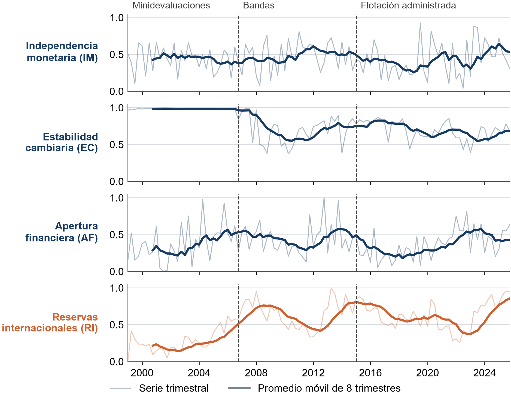

# El trilema macroeconómico en Costa Rica y el papel de las reservas internacionales, 1999-2025

Joseph A. Atencio Arias y Marco Oconitrillo González, Escuela de Economía, Universidad de Costa Rica, mayo de 2026

Este repositorio contiene los datos, el código y el artículo de un estudio sobre cómo ha combinado Costa Rica la estabilidad cambiaria, la independencia monetaria y la apertura financiera desde 1999, y qué papel cumplen las reservas internacionales en esa combinación. Los índices trimestrales del trilema se construyen desde los datos crudos y la restricción del trilema, con y sin reservas, se estima para cada régimen cambiario.

El artículo está en [`report/trilema_reservas_costa_rica.pdf`](report/trilema_reservas_costa_rica.pdf). El código es el paquete `trilema`, en `src/`, y [`notebooks/analisis.ipynb`](notebooks/analisis.ipynb) recorre los resultados.

## Resultados principales

Después de 2006 la estabilidad cambiaria concentra el 67.9 % del peso del trilema, y el 78.1 % bajo flotación administrada. Agregar las reservas mejora poco el ajuste (el R² pasa de 0.971 a 0.973), pero su coeficiente es significativo después de 2006, con un peso de 14.8 % en la muestra robusta y de 23.1 % bajo bandas cambiarias. En primeras diferencias, más reservas se asocian con menor inflación, con coeficientes de −6.2 a −6.5 significativos al 5 %, y la apertura comercial es el otro determinante robusto. Son asociaciones y no efectos causales.

| Muestra robusta, 2006Q4 a 2025Q4 | Trilema | Con reservas |
|---|---:|---:|
| Independencia monetaria (IM) | 0.804*** | 0.707*** |
| Estabilidad cambiaria (EC) | 1.906*** | 1.597*** |
| Apertura financiera (AF) | 0.653*** | 0.586*** |
| Reservas internacionales (RI, normalizadas) | | 0.454*** |
| Observaciones | 77 | 77 |
| R² | 0.971 | 0.973 |

Restricción `2 = b1 IM + b2 EC + b3 AF (+ b4 RI) + e`, sin intercepto y con errores HAC. \*\*\* p < 0.01. En las minidevaluaciones el R² es 1 por construcción, porque EC es casi constante, así que la referencia es la muestra que excluye ese régimen.



## Summary in English

This repository contains the data, code and paper for a study of how Costa Rica has combined exchange-rate stability, monetary independence and financial openness since 1999, and of the role of international reserves. Quarterly trilemma indices are built from raw data, and the trilemma constraint, with and without reserves, is estimated for each exchange-rate regime. Exchange-rate stability carries about two thirds of the weight after 2006, reserves add a complementary component, and higher reserves are associated with lower inflation. The paper is in Spanish. The tests in `tests/` check that the code reproduces every coefficient in its tables.

## Datos

Los datos crudos están en `data/raw/` y vienen del Banco Central de Costa Rica, FRED, el FMI y el Banco Mundial. La base trimestral que usa el análisis se guarda en `data/processed/base_trimestral.csv`. [`data/README.md`](data/README.md) describe cada archivo y cada variable. Los datos pertenecen a sus fuentes.

## Requisitos

Los resultados se generaron con Python 3.12.10 en Windows 11 y con las versiones de los paquetes que fija `requirements.txt`. El análisis completo corre en menos de un minuto y las pruebas en unos diez segundos, sin números aleatorios.

## Cómo reproducir los resultados

Desde la carpeta del repositorio se instalan los paquetes y el código del análisis.

```bash
pip install -r requirements.txt
```

```bash
pip install -e . --no-deps
```

Luego se corre el análisis y se comprueban las cifras del artículo.

```bash
python -m trilema
```

```bash
pytest
```

`python -m trilema` construye la base desde los datos crudos y guarda las tablas de `outputs/tables/`, las figuras de `outputs/figures/` y las figuras del artículo en PDF, en la carpeta `report/latex/figures/`, que no forma parte del repositorio. `pytest` comprueba que los coeficientes, los errores estándar, los R², las participaciones y las interacciones coincidan con los del artículo, y GitHub Actions repite esas pruebas con cada cambio.

## Contenido

| Ruta | Contenido |
|---|---|
| `data/raw/` | Datos originales |
| `data/processed/` | Base trimestral construida |
| `src/trilema/indices.py` | Índices de independencia monetaria, estabilidad cambiaria y apertura financiera |
| `src/trilema/base.py` | Unión de los índices con las variables macroeconómicas |
| `src/trilema/modelos.py` | Restricciones, participaciones, regresiones sobre la inflación e interacciones |
| `src/trilema/diagnosticos.py` | Raíz unitaria, cointegración, causalidad de Granger y quiebres |
| `src/trilema/figuras.py` | Figuras del artículo |
| `src/trilema/flujo.py` | Corre todo y guarda los resultados |
| `tests/` | Comprobación de las cifras del artículo |
| `notebooks/analisis.ipynb` | Recorrido por los resultados, ya ejecutado |
| `outputs/` | Tablas en CSV y figuras en PNG |
| `report/` | El artículo en PDF |

## Correspondencia entre el artículo y el código

| En el artículo | Código | Tabla en `outputs/tables/` |
|---|---|---|
| Figura 1, índices del trilema y reservas | `indices.py`, `figuras.panel_indices` | |
| Cuadro 1, restricción del trilema | `modelos.restriccion` | `cuadro1_trilema` |
| Cuadro 2, restricción con reservas | `modelos.restriccion` | `cuadro2_cuadrilema` |
| Figura 2, participación de cada componente | `modelos.participaciones` | `participacion_trilema`, `participacion_cuadrilema` |
| Cuadro 3, inflación en primeras diferencias | `modelos.pares_de_vertices` | `cuadro3_inflacion_diferencias` |
| Interacciones con las reservas | `modelos.interacciones`, `modelos.interacciones_por_par` | `interacciones_vertice_reservas`, `interacciones_pares_reservas` |
| Pruebas de raíz unitaria, Johansen, Granger y quiebres | `diagnosticos.py` | `diagnostico_*` |
| Figura 3, reservas sobre el PIB, 1960-2024 | `base.reservas_largo_plazo` | `reservas_pib_1960_2024` |

## Cómo citar

Atencio Arias, J. A. y Oconitrillo González, M. (2026). *El trilema macroeconómico en Costa Rica y el papel de las reservas internacionales, 1999-2025*. Escuela de Economía, Universidad de Costa Rica.

El archivo `CITATION.cff` tiene los mismos datos, y GitHub los muestra en otros formatos en el botón «Cite this repository».
