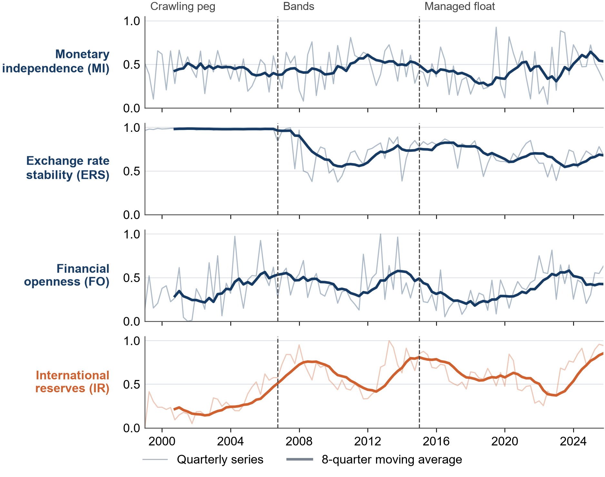

English | [Español](README.es.md)

# The Macroeconomic Trilemma in Costa Rica and the Role of International Reserves, 1999-2025

Joseph A. Atencio Arias and Marco Oconitrillo González, School of Economics, University of Costa Rica, May 2026

This repository contains the data, code and paper of a study of how Costa Rica has combined exchange rate stability, monetary independence and financial openness since 1999, and what role international reserves play in that combination. The quarterly trilemma indices are built from the raw data, and the trilemma constraint, with and without reserves, is estimated for each exchange rate regime.

The paper is in [`report/trilema_reservas_costa_rica_en.pdf`](report/trilema_reservas_costa_rica_en.pdf), with the Spanish version in [`report/trilema_reservas_costa_rica.pdf`](report/trilema_reservas_costa_rica.pdf). The code is the `trilema` package, in `src/`, and [`notebooks/analisis.ipynb`](notebooks/analisis.ipynb) walks through the results. The code and its comments are in Spanish, and they use the Spanish abbreviations IM, EC, AF and RI for MI, ERS, FO and IR.

## Main results

After 2006, exchange rate stability carries 67.9% of the weight of the trilemma, and 78.1% under the managed float. Adding reserves improves the fit only slightly (the R² goes from 0.971 to 0.973), but their coefficient is significant after 2006, with a weight of 14.8% in the robust sample and 23.1% under the exchange rate bands. In first differences, more reserves are associated with lower inflation, with coefficients from −6.2 to −6.5 significant at 5%, and trade openness is the other robust determinant. These are associations, not causal effects.

| Robust sample, 2006Q4 to 2025Q4 | Trilemma | With reserves |
|---|---:|---:|
| Monetary independence (MI) | 0.804*** | 0.707*** |
| Exchange rate stability (ERS) | 1.906*** | 1.597*** |
| Financial openness (FO) | 0.653*** | 0.586*** |
| International reserves (IR, normalized) | | 0.454*** |
| Observations | 77 | 77 |
| R² | 0.971 | 0.973 |

Constraint `2 = b1 MI + b2 ERS + b3 FO (+ b4 IR) + e`, without intercept and with HAC errors. \*\*\* p < 0.01. Under the crawling peg the R² is 1 by construction, because ERS is almost constant, so the reference is the sample that excludes that regime.



## Data

The raw data are in `data/raw/` and come from the Central Bank of Costa Rica, FRED, the IMF and the World Bank. The quarterly dataset used in the analysis is saved in `data/processed/base_trimestral.csv`. [`data/README.md`](data/README.md), in Spanish, describes each file and each variable. The data belong to their sources.

## Requirements

The results were produced with Python 3.12.10 on Windows 11 and with the package versions pinned in `requirements.txt`. The full analysis runs in less than a minute and the tests in about ten seconds, with no random numbers.

## How to reproduce the results

From the repository folder, install the packages and the analysis code.

```bash
pip install -r requirements.txt
```

```bash
pip install -e . --no-deps
```

Then run the analysis and check the numbers in the paper.

```bash
python -m trilema
```

```bash
pytest
```

`python -m trilema` builds the dataset from the raw data and saves the tables in `outputs/tables/`, the figures in `outputs/figures/` and the paper's figures as PDF, in the folder `report/latex/figures/`, which is not part of the repository. It also draws the same figures with English labels, in the `en/` subfolders, and writes the tables and numbers of the English version of the paper in `report/latex/en/tables/`. `pytest` checks that the coefficients, standard errors, R², shares and interactions match those in the paper, and GitHub Actions repeats those tests with every change.

## Contents

| Path | Contents |
|---|---|
| `data/raw/` | Original data |
| `data/processed/` | Quarterly dataset built from them |
| `src/trilema/indices.py` | Indices of monetary independence, exchange rate stability and financial openness |
| `src/trilema/base.py` | Merge of the indices with the macroeconomic variables |
| `src/trilema/modelos.py` | Constraints, shares, inflation regressions and interactions |
| `src/trilema/diagnosticos.py` | Unit roots, cointegration, Granger causality and breaks |
| `src/trilema/figuras.py` | Figures of the paper, in Spanish and in English |
| `src/trilema/articulo_ingles.py` | Tables and numbers of the English version of the paper |
| `src/trilema/flujo.py` | Runs everything and saves the results |
| `tests/` | Check of the numbers in the paper |
| `notebooks/analisis.ipynb` | Walk-through of the results, already executed |
| `outputs/` | Tables as CSV and figures as PNG, with the English figures in `figures/en/` |
| `report/` | The paper as PDF, in Spanish and in English |

## Mapping between the paper and the code

| In the paper | Code | Table in `outputs/tables/` |
|---|---|---|
| Figure 1, trilemma indices and reserves | `indices.py`, `figuras.panel_indices` | |
| Table 1, trilemma constraint | `modelos.restriccion` | `cuadro1_trilema` |
| Table 2, constraint with reserves | `modelos.restriccion` | `cuadro2_cuadrilema` |
| Figure 2, share of each component | `modelos.participaciones` | `participacion_trilema`, `participacion_cuadrilema` |
| Table 3, inflation in first differences | `modelos.pares_de_vertices` | `cuadro3_inflacion_diferencias` |
| Interactions with reserves | `modelos.interacciones`, `modelos.interacciones_por_par` | `interacciones_vertice_reservas`, `interacciones_pares_reservas` |
| Unit root, Johansen, Granger and break tests | `diagnosticos.py` | `diagnostico_*` |
| Figure 3, reserves to GDP, 1960-2024 | `base.reservas_largo_plazo` | `reservas_pib_1960_2024` |

## How to cite

Atencio Arias, J. A. and Oconitrillo González, M. (2026). *The macroeconomic trilemma in Costa Rica and the role of international reserves, 1999-2025*. School of Economics, University of Costa Rica.

The `CITATION.cff` file has the same reference for the Spanish version, and GitHub shows them in other formats under the "Cite this repository" button.
